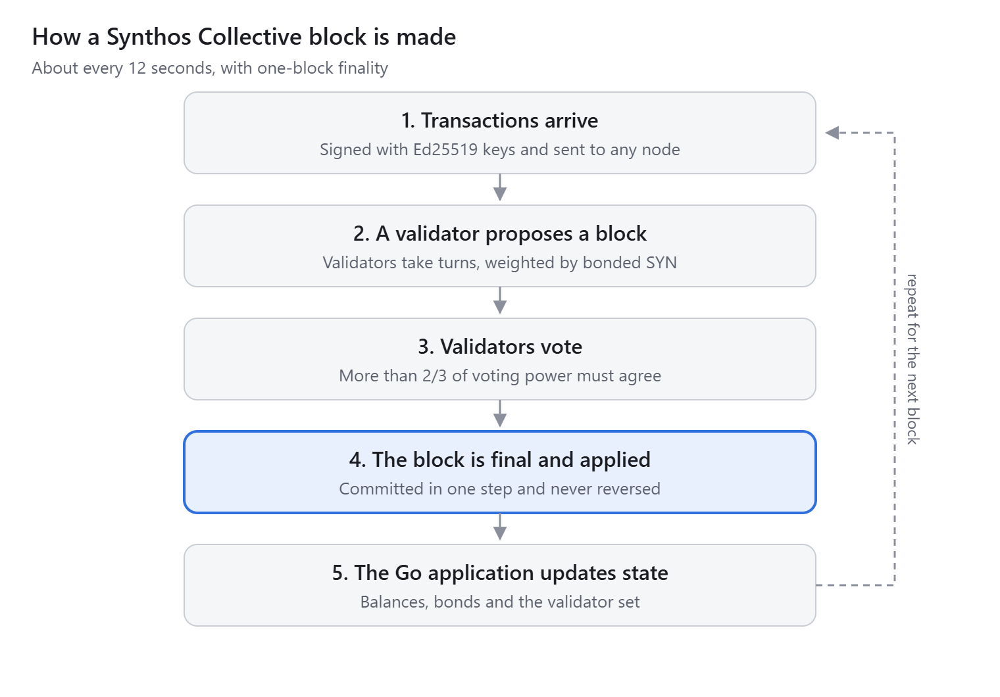
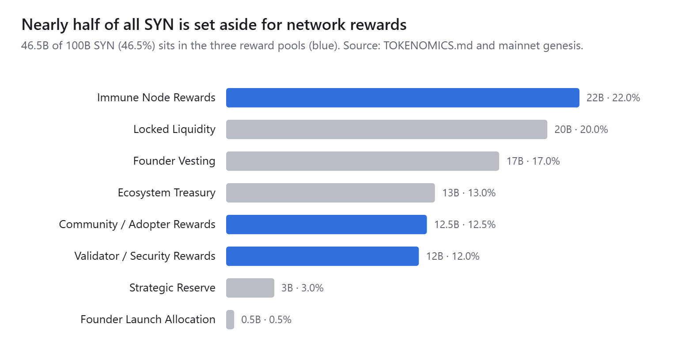

# What Is Synthos Collective? A Plain-English Guide to the Layer 1

*By James Isham Williams, founder of Synthos Collective · October 28, 2026*

## TL;DR

Synthos Collective is an independent Layer 1 blockchain, written in Go, that has run on CometBFT consensus since October 22, 2026. Four validators with equal stake produce a block about every 12 seconds, and each block is final the moment it is committed. Two of those validators are rented servers; the other two are ordinary HP desktops in a home. The native coin is SYN, with a fixed supply of 100 billion. Synthos Collective also posts its block fingerprints to Base, so anyone can check its history against a second, independent chain.

## The problem: validators live in a few data centers

A blockchain is only as independent as the machines that run it. Across the industry, a lot of validators sit with a small number of cloud and hosting companies, so one provider's outage or policy change can hit many of them at once.

Synthos Collective is built to test a different setup: validators that run on everyday hardware, next to rented servers, with no single company holding the majority. The node software needs no special rig, and a home validator connects out to the network rather than requiring open ports.

## How the chain works

Synthos Collective splits the work in two. CometBFT, the consensus engine behind many Cosmos chains, orders and finalizes blocks; a Go application decides what each transaction does to balances and stakes.

- **Block time:** about 12 seconds on average; when idle, the chain still makes a block at least every 10 seconds.
- **Finality:** one block. Once committed, a block is never reversed.
- **Accounts:** Ed25519 keys; an address is the first 20 bytes of the SHA-256 hash of the public key.
- **Joining as a validator:** bond at least 10,000 SYN with a validator\_bond transaction. Voting power equals the bond, and the validator set updates every 100 blocks.
- **Leaving:** unbonded SYN unlocks after 86,400 blocks, about 12 days at the current pace.
- **Penalties:** signing two different blocks at the same height costs 5% of the bond and permanently removes the validator.

## The validator network today

Four validators secure Synthos Collective, each with 1,000,000 SYN bonded, so each holds 25% of the voting power.

| Validator | Machine | Location | Bond (SYN) | Joined |
| --- | --- | --- | --- | --- |
| hosteons-validator-1 | Rented VPS | Salt Lake City, US | 1,000,000 | Genesis, Oct 22, 2026 |
| jim-pc-validator-1 | Home desktop PC | California, US | 1,000,000 | Genesis, Oct 22, 2026 |
| hosteons-validator-ny-1 | Rented VPS | New York, US | 1,000,000 | Block 27,496 |
| jim-tower-validator-4 | Home HP tower | California, US | 1,000,000 | Block 33,034 |

CometBFT needs more than two-thirds of the voting power to agree on every block. With four equal validators, any one of them can go offline and the other three, at 75%, keep the chain running. If two go down at the same time, block production pauses until one returns; no blocks are lost or reversed.

## SYN tokenomics

SYN has a fixed supply of 100 billion, all created at genesis, and nearly half of it is earmarked for rewarding the people who run and use the network.

- **Founder vesting:** 17B SYN unlocks in 10 equal yearly releases of 1.7B, each on May 29.
- **Founder launch allocation:** 500M SYN at launch, for legal work, audits, infrastructure and validators.
- **Validator rewards (planned):** a one-time 10,000 SYN activation reward per approved validator, then 5,000 SYN a month for uptime.
- **Staking:** validators lock SYN as a bond; it stays the owner's and unlocks about 12 days after unbonding.

SYN is not listed or traded on any exchange today.

## Live on Base: the SynthosAnchor contract

Synthos Collective records its block fingerprints on Base, Coinbase's Ethereum layer 2, through a small contract called SynthosAnchor. Each record stores a Synthos Collective block height, that block's hash and its state hash, so anyone can check the chain's history against a public ledger that Synthos Collective does not control.

- Contract: [0xae4C167ff08d13CaC9b397D13c50904bb9c881a5](https://basescan.org/address/0xae4C167ff08d13CaC9b397D13c50904bb9c881a5) on Base mainnet
- First record: Synthos Collective block 42,288, written in [this transaction](https://basescan.org/tx/0xa8b5f38cd429a2aded5fc0a1c89fd7fb8136b0843970d273a63a4cb755246afa) on October 28, 2026
- Only one approved relayer can write, and heights must always go up, so old records can't be rewritten

SYN itself is not on Base and is not traded on any exchange. The anchor proves history; it doesn't move tokens.

## Honest status and what's next

Synthos Collective is live and producing blocks, but it is early. All four validators are run by the founder today, so the network is spread across machines and locations, not yet across independent operators.

Known limits right now:

- Both home validators share one home internet connection, and both servers use the same hosting company. Either outage takes down two validators at once and pauses the chain until one is back.
- Blocks are mostly empty; there is no outside transaction volume yet.
- The Base anchor is posted by hand for now; hourly automatic posting is the next step.
- History from before the October 22 switch to CometBFT, more than 75,000 blocks from the chain's original engine, is kept on a single server.

Next up:

1. Bring in outside node operators and validators.
2. Automate the hourly Base anchor.
3. Archive the full chain history, both engines, on Filecoin, which is the subject of an [open grant proposal](https://github.com/filecoin-project/devgrants/issues/2227).

## How to get involved

- **Run a node:** the 1-click Windows node is at [www.ishamwilliamsblockchains.com](https://www.ishamwilliamsblockchains.com) (type the www.).
- **Read the code:** everything is open source under Apache-2.0 on [GitHub](https://github.com/elpresidentebutch-ctrl/synthos-collective) and [GitLab](https://gitlab.com/synthos-collective-group/synthos-collective).
- **Check the chain yourself:** the live explorer is at [82-29-54-7.sslip.io](https://82-29-54-7.sslip.io), and the Base anchor is on [Basescan](https://basescan.org/address/0xae4C167ff08d13CaC9b397D13c50904bb9c881a5).
- **Follow along:** [@elpresidentejim](https://x.com/elpresidentejim) on X and [James Isham Williams](https://www.linkedin.com/in/isham224369/) on LinkedIn.

## Sources

Figures come from the live Synthos Collective chain (CometBFT status and validator set, read October 28, 2026), the project's [TOKENOMICS.md](https://github.com/elpresidentebutch-ctrl/synthos-collective/blob/main/docs/TOKENOMICS.md) and genesis file, and the SynthosAnchor contract on [Basescan](https://basescan.org/address/0xae4C167ff08d13CaC9b397D13c50904bb9c881a5).
