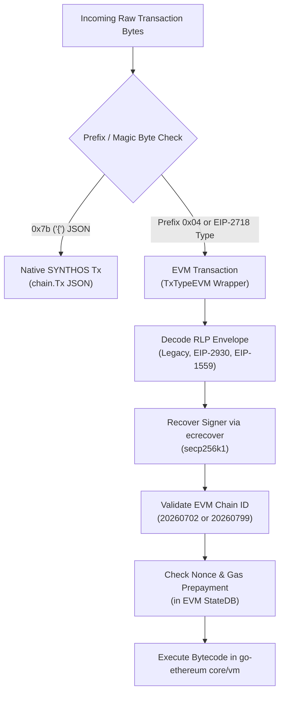
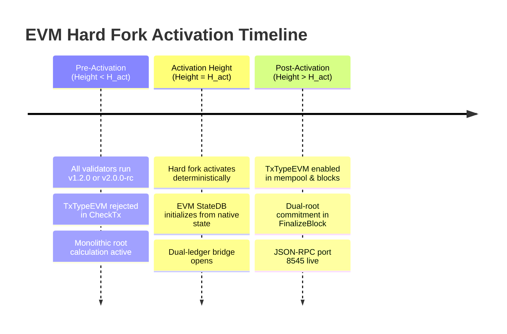

# EVM Integration Design Specification for SYNTHOS Collective

**Author:** Antigravity (prepared for Jim & Claude)  
**Status:** DRAFT (Phase 1 Groundwork)  
**Branch:** `feature/evm-foundation`  
**Target Mainnet:** `synthos-mainnet-1` (Activation Height hard fork)  
**Mainnet EVM Chain ID:** `20260702` (Free on Chainlist / `ethereum-lists`)  
**Isolated Devnet Chain ID:** `20260799` (Network: `synthos-evm-devnet-1`)  

---

## 1. Executive Summary

This design specification details the architecture for embedding an Ethereum Virtual Machine (EVM) directly into SYNTHOS Collective (`synthos-mainnet-1`).

Currently, SYNTHOS runs on CometBFT v0.38.26 with an application state machine (`cometapp`) supporting fixed transaction types (transfers, citizen staking, cross-chain bridge locks/releases, internal DEX orderbook, and governance). Adding an embedded EVM unlocks full Solidity smart contract programmability, allowing standard Web3 tooling (MetaMask, Hardhat, Foundry, ethers.js, viem) to interface with SYNTHOS natively.

To preserve validator safety and network stability, this transition follows a strict 5-phase plan. **Phase 1 (this phase) is purely non-consensus groundwork**:
1. Zero changes to running validators or live mainnet consensus.
2. Key-value state storage modernization behind the existing `State` interface, maintaining byte-for-byte root hash equivalence.
3. Standalone EVM devnet with an isolated chain ID (`20260799`) for safe experiments.
4. Comprehensive design decisions and transaction format specifications.
5. All changes subject to Claude's review before merging.

---

## 2. The Six Architectural Decisions

### Decision 1: EVM Execution Engine — `go-ethereum` (`core/vm`)

**Decision:** Assume and embed **`go-ethereum` (`core/vm`)**.

| Attribute | Specification |
| :--- | :--- |
| **Engine Package** | `github.com/ethereum/go-ethereum/core/vm` (along with `core/types` and `params`) |
| **Language** | Pure Go (native compilation, no CGO required: `CGO_ENABLED=0` preserved) |
| **License** | **LGPL-3.0** (with internal boundary isolation) |
| **Determinism** | 100% deterministic bytecode execution verified against Ethereum execution specs |

#### Technical Evaluation & Architecture:
- `go-ethereum` (`core/vm`) is the battle-tested standard powering Ethereum mainnet, Polygon PoS, Arbitrum, Optimism, and BNB Chain.
- Native Go avoids CGO (`cgo`), maintaining SYNTHOS's reproducible cross-compilation pipeline across Linux amd64/arm64 and Windows.
- Alternative engines like `evmone` (C++) or `revm` (Rust) require CGO/FFI bindings, breaking static linking and increasing binary surface area. Cosmos/Ethermint would require discarding SYNTHOS's clean, lightweight custom Go state machine (`cometapp`).

#### Licensing & Boundary Isolation Strategy:
- Synthos Collective is licensed under Apache-2.0. To comply with LGPL-3.0 requirements without compromising project licensing:
  1. The EVM execution runtime is encapsulated in an isolated internal package (`internal/evm/executor`), interfacing only through clean Go interfaces (`StateDB`, `BlockContext`, `TxContext`).
  2. The go-ethereum dependency is linked as an unmodified external Go module.
  3. All source code and build instructions remain public under Apache-2.0, fulfilling LGPL-3.0 source availability and object-relinking provisions.

---

### Decision 2: Unit Denominations and Decimals — Dual-Ledger Balance Model

**Decision:** Maintain **18-decimal EVM balances** via a **Dual-Ledger Balance Model**.

* **Native Ledger (0 Decimals):**
  - Native balances remain whole SYN (`uint64`), preserving all existing native transfers, staking, DEX orderbooks, and validator rewards without breaking arithmetic changes.
* **EVM Ledger (18 Decimals):**
  - EVM contract accounts and EVM user accounts carry balances denominated in wei ($10^{18}$ wei per SYN coin), represented as `*big.Int`.
* **Atomic Boundary Conversion:**
  - $1 \text{ SYN} = 10^{18} \text{ wei} = 1,000,000,000,000,000,000 \text{ wei}$.
  - Conversions between native accounts and EVM accounts occur through an explicit, atomic bridge action (`deposit_to_evm` / `withdraw_from_evm`).
  - Fractional wei balances cannot leak into the native 0-decimal ledger: withdrawals round down to whole SYN, with dust remainder retained in the user's EVM balance.

---

### Decision 3: Accounts and Cryptographic Signatures — Dual Account Spaces

**Decision:** **Dual Account Spaces** with native Ed25519 and EVM secp256k1 keys.

* **Native Account Space:**
  - **Key Type:** Ed25519.
  - **Address Derivation:** `0x` + first 20 bytes of $\text{SHA-256}(\text{PubKey})$.
  - **Signature Algorithm:** Pure Ed25519 over canonical JSON transaction bytes.
* **EVM Account Space:**
  - **Key Type:** ECDSA secp256k1.
  - **Address Derivation:** Standard Ethereum format: last 20 bytes of $\text{Keccak-256}(\text{PubKey})$.
  - **Signature Algorithm:** Standard Ethereum `secp256k1` (`ecrecover` over transaction hash with EIP-155 / EIP-1559 chain ID replay protection).
* **Interoperability:**
  - An operator can hold both an Ed25519 native key (for validator operations and native transfers) and a secp256k1 EVM key (for MetaMask, DeFi, and smart contract interaction).
  - Native transactions can fund an EVM address via `deposit_to_evm`.

---

### Decision 4: Gas Metering and Block Fees

**Decision:** Canonical EVM gas schedule integrated with **SYNTHOS Fee Model V3**.

* **Block Gas Limit:** $30,000,000$ gas per CometBFT block.
* **Opcode Gas Schedule:** Inherit canonical Ethereum Cancun/Prague gas costs (e.g. 21,000 base gas for standard transfer, dynamic memory and storage expansion gas).
* **Fee Model V3 Integration:**
  - For native transactions: base fee per transaction dynamically adjusts with block congestion.
  - For EVM transactions:
    $$\text{Effective Gas Price} = \text{base\_fee\_per\_gas} + \text{priority\_fee}$$
  - $\text{base\_fee\_per\_gas}$ is derived directly from the Fee Model V3 congestion tracker.
  - Fee split: 50% burned, remainder distributed to block proposer and validator fee epoch pool according to existing consensus rules.

---

### Decision 5: State Storage Evolution (Phase 1 Core)

**Decision:** Transition from monolithic JSON serialization to an embedded **Key-Value State Store** behind the existing `State` interface.

* **Current Baseline:** Every block currently serializes the entire state tree into a monolithic JSON file (`synthos-app-state.json`) and recomputes the Merkle root across all accounts from scratch.
* **Target KV Architecture:**
  - Replace monolithic file serialization with a structured Key-Value storage abstraction (`StateStore`).
  - Key namespaces:
    - `acc:<address>` -> serialized account state (balance, nonce, assets, code hash, storage root).
    - `sys:<subsystem>` -> consensus metadata (bridge records, validators, fee epoch, base fee).
  - Incremental Merkle root recomputation: touched accounts update their leaf hashes without rehashing the entire account database.
  - Guaranteed byte-for-byte equivalence with legacy state roots during pre-activation heights.

---

### Decision 6: Chain ID and RPC Interface

**Decision:** Mainnet EVM Chain ID **`20260702`**, isolated Devnet Chain ID **`20260799`**, with standard JSON-RPC on port 8545.

* **Mainnet Chain ID:**
  - CometBFT Chain ID: `synthos-mainnet-1`
  - EVM Chain ID: **`20260702`** (Checked against Chainlist / `ethereum-lists/chains`; verified unallocated).
* **Devnet Chain ID (Isolated):**
  - CometBFT Chain ID: `synthos-evm-devnet-1`
  - EVM Chain ID: **`20260799`** (Never 20260702, never mainnet).
* **Embedded JSON-RPC Layer:**
  - Implements standard `eth_*`, `net_*`, and `web3_*` endpoints over HTTP/WebSocket (default port `8545`).
  - Supports MetaMask, Hardhat, Foundry, Remix, and standard Ethereum block explorers without proprietary modifications.

---

## 3. The New Ethereum Transaction Type (`TxTypeEVM`)

To support standard Ethereum transactions alongside native SYNTHOS transactions, we introduce the `TxTypeEVM` envelope into the CometBFT transaction stream.

### 3.1 Transaction Envelope Specification

A transaction submitted to CometBFT can be either:
1. A **Native Transaction**: Canonical JSON encoding conforming to `chain.Tx`.
2. An **EVM Transaction (`TxTypeEVM`)**: A typed byte envelope wrapping standard RLP-encoded Ethereum transactions.



### 3.2 Wire Format and EIP-2718 Compatibility

The EVM transaction wrapper supports:
* **Legacy Transactions (Type 0x00):** Standard RLP `[nonce, gasPrice, gasLimit, to, value, data, v, r, s]` with EIP-155 replay protection.
* **EIP-2930 Transactions (Type 0x01):** Optional access list transactions.
* **EIP-1559 Transactions (Type 0x02):** Dynamic fee transactions `[chainId, nonce, maxPriorityFeePerGas, maxFeePerGas, gasLimit, to, value, data, accessList, v, r, s]`.

```go
// EVMTxEnvelope wraps a standard Ethereum transaction for CometBFT inclusion.
type EVMTxEnvelope struct {
    Type     byte   `json:"type"`      // EIP-2718 transaction type (0x00, 0x01, 0x02)
    RawRLP   []byte `json:"raw_rlp"`   // Raw canonical RLP bytes
    TxHash   string `json:"tx_hash"`   // Keccak-256 hash (0x-prefixed)
    Sender   string `json:"sender"`    // Recovered checksummed Ethereum address
}
```

### 3.3 Lifecycle in CometBFT ABCI++

1. **`CheckTx` (Mempool Validation):**
   - Check if block height $\ge \text{EVMActivationHeight}$ (reject with error code if premature).
   - Recover sender address using `ecrecover`.
   - Verify `ChainID` strictly matches the network's EVM Chain ID (`20260702` on mainnet, `20260799` on devnet).
   - Verify sender has sufficient balance in the EVM StateDB to cover $\text{gasLimit} \times \text{maxFeePerGas} + \text{value}$.
   - Verify transaction nonce matches sender's current EVM state nonce.
2. **`FinalizeBlock` (Deterministic Execution):**
   - Instantiate `core/vm.EVM` configured with block header parameters (block number, timestamp, base fee, block gas limit).
   - Execute EVM message call or contract creation.
   - Deduct gas consumed; burn 50% of base fee; credit priority tip to block proposer.
   - Store transaction receipt (status, gas used, logs/bloom filter) in the local index.
   - Update EVM StateDB root.

---

## 4. The Activation-Height Plan

Hard fork activation of the EVM must be coordinate-able across all validators with zero risk of consensus divergence.



### 4.1 Activation Parameters

In `internal/chain` and `cometapp/app`:
```go
// EVMActivationHeight defines the block height at which EVM execution
// activates on the network. A value of 0 disables EVM execution indefinitely.
const EVMActivationHeight uint64 = 450000 // Planned target block height
```

### 4.2 Pre-Activation Rules (Height $< \text{EVMActivationHeight}$)
- Any transaction of type `TxTypeEVM` is rejected in `CheckTx` with error: `EVM not active until height <EVMActivationHeight>`.
- Block building (`PrepareProposal` / `ProcessProposal`) forbids inclusion of EVM transactions.
- State root calculation is 100% identical to legacy formula.

### 4.3 Transition Block (Height $= \text{EVMActivationHeight}$)
- CometBFT `FinalizeBlock` executes the genesis EVM state setup:
  - EVM state root initializes cleanly.
  - Bridge contract or system precompiles are registered.
- An ABCI event `evm_hardfork_activated` is emitted to block receipts.

### 4.4 Rollback & Emergency Invariant
- If an issue is discovered on testnet before mainnet activation, the activation height can be deferred by node configuration without breaking historical blocks.
- Node binaries refuse to run if their compiled or configured activation height disagrees with network genesis/consensus parameters.

---

## 5. State Storage Baseline & Scaling Analysis (Task 2 Benchmarks)

Measured on an isolated state copy (`state-copy.json`, current mainnet height 385,096) without touching running validator processes.

### 5.1 Mainnet Baseline Snapshot (Height 385,096)

| Metric | Measured Value | Notes |
| :--- | :--- | :--- |
| **State File Size** | 5,123 bytes (5.00 KB) | Monolithic JSON on disk |
| **Active Accounts** | 18 | Base native accounts |
| **Deserialization Time** | ~1.38 ms | Loading from disk into memory |
| **Save Time (Marshal + Disk Sync)** | ~4.44 ms | `json.MarshalIndent` + temp write + atomic rename |
| **State Root Rebuild Time** | ~74.54 µs | `State.Root()` over 18 sorted accounts |
| **Baseline Root Hash** | `0x3c6432643022ee19803bb3ef9b887e92860d4525c51ccefbef2a9aae042042d2` | Canonical Merkle root at height 385,096 |

### 5.2 Scaled Growth Projections (Monolithic JSON vs. Full Root Rebuild)

Under the current architecture, every block serializes the entire state tree to JSON and rebuilds the Merkle root from scratch over all accounts:

| Account Count | Projected JSON Size | In-Memory Marshal Time | Full Merkle Rebuild Time | Total Block Disk & Rebuild Latency |
| :--- | :--- | :--- | :--- | :--- |
| **18 (Current)** | **5.00 KB** | **~1.38 ms** | **~74.5 µs** | **~4.44 ms** |
| **100** | 11.81 KB | < 1 ms | < 1 ms | < 5 ms |
| **1,000** | 86.61 KB | 21.05 ms | 24.64 ms | ~50 ms |
| **10,000** | 842.57 KB | 24.74 ms | 26.96 ms | ~60 ms |
| **50,000** | 4.14 MB | 111.25 ms | 180.29 ms | ~300 ms |
| **100,000** | 8.29 MB | 205.99 ms | 240.48 ms | ~500 ms |

### 5.3 Implications for EVM Integration
1. **Storage Amplification:** Smart contract deployment and storage slots create exponential key growth. While native accounts represent ~85 bytes per entry, EVM contract storage slots (`uint256 -> uint256`) would expand a 100,000-contract ecosystem to hundreds of megabytes.
2. **I/O Bottleneck:** Writing 50MB+ of JSON every 11-second block causes disk write wear and latency spikes that jeopardize consensus round timers.
3. **Conclusion:** Phase 1 migration to a key-value store behind the `State` interface is strictly mandatory before enabling EVM transactions in Phase 2.

---

## 6. Phased Implementation Roadmap

1. **Phase 1: Storage Engine Modernization & EVM Devnet (Weeks 1–6) [CURRENT]**
   - Prototype KV state store behind `State` interface; prove byte-for-byte root hash equivalence.
   - Establish isolated EVM devnet (`synthos-evm-devnet-1`, Chain ID `20260799`).
   - Benchmark state serialization and access latencies.
2. **Phase 2: Embedded EVM Engine & StateDB Adapter (Weeks 7–12)**
   - Implement `core/vm.StateDB` interface over the KV store.
   - Embed EVM executor into CometBFT `FinalizeBlock` for `TxTypeEVM`.
   - Pass Ethereum official consensus state tests (`GeneralStateTests`).
3. **Phase 3: Ethereum JSON-RPC & Tooling (Weeks 13–16)**
   - Implement standard `eth_*` RPC endpoints (port 8545).
   - Test MetaMask, Hardhat, Foundry, and Remix end-to-end.
4. **Phase 4: Public EVM Testnet Soak (Weeks 17–22)**
   - Deploy multi-validator public EVM testnet.
   - Run validator soak test under synthetic load and fuzz testing.
5. **Phase 5: External Audit & Mainnet Hard Fork (Weeks 23–26)**
   - Third-party security audit of consensus and EVM integration.
   - Coordinate hard fork activation block height on `synthos-mainnet-1`.

---

## 7. Immediate Safety Invariants

1. **Zero Consensus Mutations on Mainnet:** All development is isolated to `feature/evm-foundation`; mainnet binary remains strictly `v1.2.0`.
2. **Validator Benchmark Isolation:** Benchmarks are run exclusively on offline local state copies—never on running validator processes.
3. **Audit Gate:** No code merges into `main` without Claude's comprehensive review and user approval.
