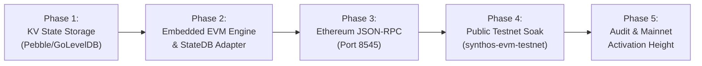

# EVM Integration Design Specification for SYNTHOS Collective

**Author:** Antigravity (reviewed for Jim & Claude)  
**Status:** DRAFT (Phase 1 Inception)  
**Branch:** `feature/evm-foundation`  
**Target Network:** `synthos-mainnet-1` (after testnet soak & outside audit)  
**EVM Chain ID:** `20260702` (Verified free on Chainlist / `ethereum-lists`)  

---

## 1. Executive Summary

This design specification details the architecture for embedding an Ethereum Virtual Machine (EVM) into SYNTHOS Collective (`synthos-mainnet-1`). 

Currently, SYNTHOS runs on CometBFT v0.38.26 with an application state machine (`cometapp`) supporting a set of fixed transaction types (transfers, citizen staking, cross-chain bridge locks/releases, internal DEX orderbook, and governance). Adding an embedded EVM unlocks full Solidity/EVM smart contract programmability, allowing developer tooling (MetaMask, Hardhat, Foundry, ethers.js, viem) to interface with SYNTHOS natively.

To preserve validator safety and network stability, this transition is planned across 5 phases over 19 to 26 weeks, requiring zero changes to live mainnet consensus until thoroughly soaked on an isolated EVM testnet and validated by an external audit.

---

## 2. The Six Architectural Decisions

### Decision 1: EVM Execution Engine (OPEN — Pending Legal Review)

The execution engine executes EVM bytecode deterministically during CometBFT's `FinalizeBlock`.

| Engine | Language | License | Trade-offs & Fit |
| :--- | :--- | :--- | :--- |
| **`go-ethereum` (`core/vm`)** | Go | **LGPL-3.0** | **Pros:** Industry gold-standard, battle-tested on Ethereum mainnet and major L2s. Native Go matches our existing node binary without CGO bindings.  **Cons / Legal:** Synthos Collective is licensed under Apache-2.0. Because Go statically compiles dependencies into a single binary, an outside IP/patent attorney must confirm LGPL-3.0 compliance terms (e.g. source distribution and object relinking provisions). |
| **`evmone`** | C++ | **Apache-2.0** | **Pros:** Fully permissive Apache-2.0 license. Fastest raw C++ execution speed.  **Cons:** Requires CGO (`cgo`). This directly breaks our deterministic cross-compilation pipeline (`CGO_ENABLED=0`), complicates reproducible release builds on Linux and Windows, and increases memory-safety surface area. |
| **Cosmos SDK + Ethermint / Evmos EVM** | Go | **Apache-2.0** | **Pros:** Mature, production-tested EVM on CometBFT with standard Cosmos modules.  **Cons:** Requires abandoning our clean, lightweight custom Go state machine (`cometapp`) and doing a disruptive, full-stack chain migration. |
| **`revm` (via C-API / FFI)** | Rust | **Apache-2.0** | **Pros:** State-of-the-art modular EVM used in Reth. Permissive license.  **Cons:** Requires Rust FFI bindings / CGO, creating cross-compilation friction similar to `evmone`. |

> **Current Decision Status:** **OPEN.**  
> Technical evaluation recommends `go-ethereum/core/vm` as the cleanest operational fit, but engine selection remains strictly open pending legal review of LGPL-3.0 linking compliance.

---

### Decision 2: Unit Denominations and Decimals (APPROVED)

Native SYN currently has **0 decimals** (balances are stored as `uint64` representing whole SYN coins). EVM smart contracts, DEX routers, and standard ERC-20 tokens expect 18 decimals (`10^18` wei per coin).

* **Option A: Dual-Ledger Balance Model (Recommended & Approved)**
  * Native ledger remains in whole SYN (`uint64`).
  * EVM accounts carry an 18-decimal balance field (`*big.Int` in wei).
  * Conversions between native and EVM spaces occur strictly at whole-SYN integer boundaries ($1 \text{ SYN} = 10^{18} \text{ wei}$).
  * *Trade-off:* Cleanly isolates native transaction logic from 18-decimal math; prevents breaking changes to all existing transactions, staking rewards, and bridge counters.
* **Option B: Total Network Migration to 18 Decimals**
  * Rescale all native balances and transaction amounts by $10^{18}$.
  * *Trade-off:* Massive breaking change touching every existing transaction type, database entry, CLI tool, fee calculation, and external service. High consensus risk.

> **Current Decision Status:** **APPROVED (Option A).**  
> Native balances remain whole SYN; EVM balances use 18 decimals, with atomic conversion across boundaries.

---

### Decision 3: Accounts and Cryptographic Signatures

* **Option A: Dual Account Spaces (Recommended)**
  * **Native Accounts:** Ed25519 keypairs, addresses derived via `0x` + first 20 bytes of $\text{SHA-256}(\text{PubKey})$.
  * **EVM Accounts:** secp256k1 keypairs, addresses derived via standard Ethereum format: last 20 bytes of $\text{Keccak-256}(\text{PubKey})$.
  * Both address types share the 20-byte address format but remain separate accounts. Moving funds between an operator's native address and their EVM address is executed via an explicit internal deposit/bridge action.
* **Option B: Unified Universal Address Space**
  * Attempt to map Ed25519 keys to EVM addresses or support Ed25519 signatures inside MetaMask.
  * *Trade-off:* Incompatible with standard Ethereum wallets and signing libraries without custom plugins/snaps.

> **Current Decision Status:** **RECOMMENDED (Option A).**

---

### Decision 4: Gas Metering and Block Fees

* **CometBFT Block Gas Limit:** Establish a target block gas limit (e.g., 30,000,000 gas per block).
* **Opcode Gas Schedule:** Inherit the canonical Ethereum Cancun/Prague gas schedule without custom modifications to prevent computational exhaustion and loop stalling.
* **Fee Model V3 Integration:**
  * Fee Model V3 dynamically computes a `base_fee` based on block congestion.
  * For EVM transactions: $\text{Effective Gas Price} = \text{base\_fee\_per\_gas} + \text{priority\_fee}$.
  * A gas-based surge threshold will run in parallel with or replace the 50-transaction count cap once activated.

---

### Decision 5: State Storage Evolution (Phase 1 Core)

* **Current Baseline:** Every block serializes the entire state tree into a monolithic JSON file (`synthos-app-state.json`), and recomputes the Merkle root across all accounts.
* **Target Architecture:** Transition from monolithic JSON to an embedded Key-Value store (**Pebble** or **GoLevelDB**) coupled with an incremental Merkle / Sparse Merkle Tree (SMT):
  * State reads and writes become $O(\log N)$ or $O(1)$ disk accesses.
  * Only touched keys are updated and rehashed per block.
  * Scales to millions of contract storage slots without degrading 11-second block commitments.

---

### Decision 6: Chain ID and RPC Interface

* **EVM Chain ID:** **`20260702`** (Checked against `chainlist.org` and `ethereum-lists/chains`; verified unallocated).
* **RPC Layer:** Embed a standard Ethereum JSON-RPC HTTP/WebSocket server listening on port `8545`:
  * Core methods: `eth_chainId`, `eth_blockNumber`, `eth_getBalance`, `eth_sendRawTransaction`, `eth_call`, `eth_estimateGas`, `eth_getTransactionReceipt`, `eth_getLogs`.
  * Allows instantaneous plug-and-play compatibility with MetaMask, Remix, Hardhat, and Foundry.

---

## 3. Phased Implementation Roadmap

1. **Phase 1: Storage Engine Modernization (Weeks 1–6)**
   - Implement Key-Value state persistence behind `chain.State`.
   - Maintain byte-for-byte root hash equivalence with current JSON engine.
   - Benchmark throughput, save time, and root rebuild overhead under stress.
2. **Phase 2: EVM Execution Module (Weeks 7–12)**
   - Implement `StateDB` interface over the KV store.
   - Embed EVM executor into CometBFT `FinalizeBlock` for `TxTypeEVM`.
   - Pass Ethereum official consensus state tests (`GeneralStateTests`).
3. **Phase 3: JSON-RPC & Wallet Integration (Weeks 13–16)**
   - Implement `eth_*` RPC endpoints.
   - Verify transaction broadcasting and event indexing via MetaMask and Hardhat.
4. **Phase 4: Public EVM Testnet (Weeks 17–22)**
   - Deploy isolated public testnet (`synthos-evm-testnet`, Chain ID `20260703`).
   - Run validator soak test across distributed VPS nodes under synthetic transaction load.
5. **Phase 5: External Audit & Mainnet Hard Fork (Weeks 23–26)**
   - Complete third-party security audit of consensus and EVM integration.
   - Publish approved node binary (e.g. `v2.0.0`) and coordinate activation block height.

---

## 4. Immediate Safety Invariants

1. **Zero Consensus Mutations on Mainnet:** All development is isolated to feature branches; mainnet binary remains strictly `v1.2.0` (commit `17eaf23` / `1b14aeb`).
2. **Validator Benchmark Isolation:** Benchmarks are run exclusively on offline local state copies—never on a live validator process or host machine before Block 380,000 (Nov 22).
3. **Audit Gate:** No EVM code will be merged into `main` without Claude's comprehensive review and user approval.

---

## 5. State Storage Baseline & Scaling Analysis (Task 2 Benchmarks)

Measured on an isolated state copy (`state-copy.json`, height 351,863) without touching running validator processes.

### 5.1 Baseline Snapshot (Height 351,863)

| Metric | Measured Value | Notes |
| :--- | :--- | :--- |
| **State File Size** | 5,122 bytes (5.00 KB) | Monolithic JSON on disk |
| **Active Accounts** | 18 | Base native accounts |
| **Deserialization Time** | ~1.09 ms | Loading from disk into memory |
| **Save Time (Marshal + Disk Sync)** | ~3.08 ms | `json.MarshalIndent` + temp write + atomic rename |
| **State Root Rebuild Time** | ~49.44 µs | `State.Root()` over 18 sorted accounts |
| **Baseline Root Hash** | `0x92cb122ef2becea729a5f25d2fd78beb76e9196b039b9a518d6ba73e9ea5fc43` | Merkle root at height 351,863 |

### 5.2 Scaled Growth Projections (Monolithic JSON vs. Full Root Rebuild)

Under the current architecture, every block serializes the entire state tree to JSON and rebuilds the Merkle root from scratch over all accounts:

| Account Count | Projected JSON Size | In-Memory Marshal Time | Full Merkle Rebuild Time | Total Block Disk & Rebuild Latency |
| :--- | :--- | :--- | :--- | :--- |
| **18 (Current)** | **5.00 KB** | **~1.5 ms** | **~49 µs** | **~3.1 ms** |
| **100** | 11.81 KB | < 1 ms | < 1 ms | < 5 ms |
| **1,000** | 86.61 KB | 1.09 ms | 2.70 ms | ~7 ms |
| **10,000** | 842.57 KB | 12.53 ms | 17.41 ms | ~45 ms |
| **50,000** | 4.14 MB | 76.56 ms | 94.42 ms | ~250 ms |
| **100,000** | 8.29 MB | 163.50 ms | 174.56 ms | ~500 ms |

### 5.3 Implications for EVM Integration

1. **Storage Amplification:** Smart contract deployment and storage slots create exponential key growth. While native accounts represent ~85 bytes per entry, EVM contract storage slots (`uint256 -> uint256`) would expand a 100,000-contract ecosystem to hundreds of megabytes.
2. **I/O Bottleneck:** Writing 50MB+ of JSON every 11-second block causes disk write wear and latency spikes that jeopardize consensus round timers.
3. **Conclusion:** Phase 1 migration to a key-value store (such as Pebble or GoLevelDB) with an incremental Merkle / Sparse Merkle Tree (SMT) is strictly mandatory before enabling EVM transactions in Phase 2.

